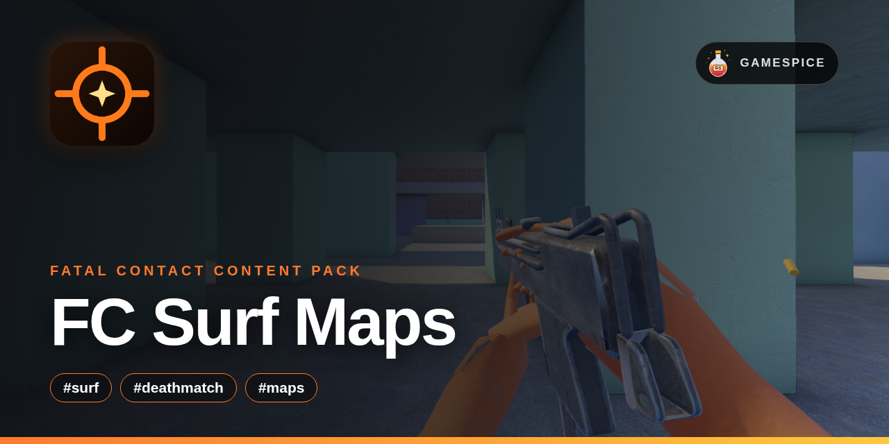

Combat surf maps for [Fatal Contact](https://github.com/zees-games/game-fatal-contact) (FC), imported from the surf genre. They are not courses. They are small maps with buy zones, weapons on the floor and teleports back to a spawn, built to fight on. Each map's manifest has `"kind": "arena"`, which is what FC looks for. A map with another kind is skipped.

Every map is somebody else's work, made for the genre years ago and imported so it can be played again. Each one is credited below and on screen when a server changes to it. If you made one of these maps and want it credited differently or taken down, open an issue and it will be done.

## Why the maps are not in the game

FC ships with its three built-in maps only. A server that wants these names them in its content configuration. Each map is its own signed pack, `gamemann/fc-surf-dm-maps-<map id>`, fetched the first time the server changes to it, so a player downloads only the map that is running. Keeping them here means a map can be added, fixed or withdrawn without a game release.

## Which maps host which modes

Every map hosts free-for-all, team deathmatch and gun game. The terrorist and counter-terrorist spawns of the genre are the red and blue team spawns, so the teams start apart and a map's start and finish teleports are untouched. `tools/check_modes.py` fails when a map lacks one of the modes or cannot give two teams of 4 spawns, and writes this table from `zones/<id>.json` (`--write`).

<!-- modes:start -->
<!-- written by tools/check_modes.py --write; edit zones/<id>.json instead -->

| Maps | Modes |
| --- | --- |
| every map (74) | free-for-all, gun game, team deathmatch |

<!-- modes:end -->

## Layout

| Path | Contents |
| --- | --- |
| `maps/<id>/<id>.json` | The map manifest the importer produced |
| `maps/<id>/<id>.bin` | Geometry and lightmap |
| `maps/<id>/provides.json` | Lists the map's pack in the Workshop (collection `fc-surf-dm-maps`) |
| `worlds/<id>/` | The shared importer's output that the game draws |
| `maps.json` | Every map with its author and source page |
| `licence.json` | Licence record per map |
| `tools/` | Pack staging and checks |

## Using it

For local development, FC's `maps/imported` is a link to this repository's `maps/` (gs-bootstrap creates it from the `# bootstrap-link:` line in the game's `.gitignore`). Without the link the game plays its built-in maps.

Releasing is a tag: `git tag v1.x.y && git push --tags`. `.github/workflows/release.yml` imports each map and attaches one `<map>-<version>-pack.zip` per map. The site publishes each as `gamemann/<map>@<version>` and signs it. Maps added after the last tag become packs at the next tag.

## Naming them on a server

A server offers a map when its server configuration (gs-server-deploy) lists it, one line per map in `maps.json`:

```yaml
games:
  game-fatal-contact:   # the Fatal Contact project directory
    maps:
      add:
        - gamemann/fc-surf-dm-maps-surf_10x_final
        - gamemann/fc-surf-dm-maps-surf_adverse
        # ... one line per map in maps.json
```

## Quality and ongoing improvement

The models, textures, animations, sounds and maps in this pack are improved automatically and recursively by AI agents. [Nightly](https://github.com/gamemann/nightly) keeps a board of improvement items. Agents pick up an item, make the change, render fresh frames and check them with a visual judge. Judge findings become new items, and the loop repeats until the result is production quality. Improvements ship as new pack versions, and the screenshots in this README are re-shot each time. Some assets are still low quality today.

## Credits

All maps are credited here and on screen. They are published under the credited-community-map exception recorded in `licence.json`. Where the source page states a licence it is shown. Where it states none, the page text does not forbid sharing or porting. If an author or anyone speaking for them wants a map removed or credited differently, open an issue at https://github.com/zees-games/fc-surf-dm-maps/issues.

| Map | Author | Source | Licence |
| --- | --- | --- | --- |
| `surf_10x_final` | Wof- | https://gamebanana.com/mods/121522 | None stated on the source page |
| `surf_10x_reloaded_fixed` | Buck Nasty | https://gamebanana.com/mods/121524 | None stated on the source page |
| `surf_110b_austinpowers` | TheInvoker | https://gamebanana.com/mods/121530 | None stated on the source page |
| `surf_29_12_06` | matrix-hetman | https://gamebanana.com/mods/121540 | None stated on the source page |
| `surf_adverse` | target practice, Archangel | https://gamebanana.com/mods/137677 | None stated on the source page |
| `surf_aim_akcolt` | Lagged | https://gamebanana.com/mods/121593 | CC BY-NC-ND 4.0 |
| `surf_akai_final` | akai | https://gamebanana.com/mods/121606 | None stated on the source page |
| `surf_bathroom_final` | smooth | https://gamebanana.com/mods/121698 | None stated on the source page |
| `surf_buck_wild` | buck nasty | https://gamebanana.com/mods/121787 | None stated on the source page |
| `surf_dust2_2008_final` | Matrix Hetman, Karatekäfer | https://gamebanana.com/mods/121962 | None stated on the source page |
| `surf_fastspiral_retro` | qdg, eintagsfliege (original) | https://gamebanana.com/mods/122039 | CC BY-NC-ND 4.0 |
| `surf_forbidden_ways_2nd` | krusty | https://gamebanana.com/mods/122075 | None stated on the source page |
| `surf_forbidden_ways_reloaded` | Krusty, sky by Karatekäfer | https://gamebanana.com/mods/122076 | None stated on the source page |
| `surf_fruits` | Sangre, Hellraisedsurfer, Robsonfire, Machine, Jaden, Komaokc, Icecreamlock, Shahzam, SKAR, JackTheStripper (copy-mark), Linus | https://gamebanana.com/mods/122092 | None stated on the source page |
| `surf_grave_reloaded` | xblah | https://gamebanana.com/mods/122151 | None stated on the source page |
| `surf_greatriver` | Ace Of Spades13 | https://gamebanana.com/mods/122158 | None stated on the source page |
| `surf_greatriver_v4` | BeNnY | https://gamebanana.com/mods/122202 | None stated on the source page |
| `surf_greatriver_xdre4m` | !Black, with Ace Of Spades13 and Junior | https://gamebanana.com/mods/122206 | None stated on the source page |
| `surf_i_hate_campers` | Snah | https://gamebanana.com/mods/122339 | CC BY-NC-ND 4.0 |
| `surf_japan_ptad` | ptad, monkeydie | https://gamebanana.com/mods/137687 | None stated on the source page |
| `surf_legends` | SintaxError | https://gamebanana.com/mods/122424 | None stated on the source page |
| `surf_machine` | Z-machine | https://gamebanana.com/mods/122477 | CC BY-NC-ND 4.0 |
| `surf_machine2` | Z-machine | https://gamebanana.com/mods/122478 | None stated on the source page |
| `surf_machine_remix_final` | paper-cut, z-machine(original) | https://gamebanana.com/mods/122497 | None stated on the source page |
| `surf_mai_redone_final2` | AndYZ, Krusty | https://gamebanana.com/mods/122504 | CC BY-NC-ND 4.0 |
| `surf_mai_remix` | Krusty | https://gamebanana.com/mods/122505 | None stated on the source page |
| `surf_matrix_v8` | Flippi273 | https://gamebanana.com/mods/122520 | None stated on the source page |
| `surf_megamachine` | grueddi, Chuck Norris | https://gamebanana.com/mods/122528 | CC BY-NC-ND 4.0 |
| `surf_ny_advance` | faj | https://gamebanana.com/mods/122641 | None stated on the source page |
| `surf_ny_bigloop_2008a` | Paper-Cut, FAJ | https://gamebanana.com/mods/122644 | None stated on the source page |
| `surf_ny_exploder_prime` | FAJ | https://gamebanana.com/mods/122646 | CC BY-NC-ND 4.0 |
| `surf_parrot_selector` | ptad | https://gamebanana.com/mods/122709 | None stated on the source page |
| `surf_pavilion` | Black Sheep | https://gamebanana.com/mods/122711 | None stated on the source page |
| `surf_poolday` | iceeater | https://gamebanana.com/mods/122736 | CC BY-NC-ND 4.0 |
| `surf_pox` | Krusty, Pariah, Karatekäfer, Korr | https://gamebanana.com/mods/122741 | None stated on the source page |
| `surf_rebel_resistance_final3` | -)RR(-ArchAngel -)RR(-Lethalis | https://gamebanana.com/mods/122824 | None stated on the source page |
| `surf_skate_park_v2` | [Happy-camper] Flan | https://gamebanana.com/mods/122946 | CC BY-NC-ND 4.0 |
| `surf_ski_2` | Massive Boredom and Mario | https://gamebanana.com/mods/122953 | None stated on the source page |
| `surf_ski_2_source` | Korliki ''Angel | https://gamebanana.com/mods/122956 | None stated on the source page |
| `surf_skyworld` | Goerge | https://gamebanana.com/mods/122985 | None stated on the source page |
| `surf_snipers_island` | Loller Dan | https://gamebanana.com/mods/137698 | CC BY-NC-ND 4.0 |
| `surf_the_flow` | G-Flow, Karatekäfer (skybox), Stavros Xanthis | https://gamebanana.com/mods/137701 | CC BY-NC-ND 4.0 |
| `surf_the_gloaming` | Roosta, Teeth | https://gamebanana.com/mods/123134 | None stated on the source page |
| `surf_thriller` | buck nasty | https://gamebanana.com/mods/123141 | None stated on the source page |
| `surf_torque2` | Sangre Nueva | https://gamebanana.com/mods/123157 | None stated on the source page |
| `surf_velocity` | copy-mark, jack the stripper, sangre, hellraisedsurfer, target practice, jesuswashomeless, skar | https://gamebanana.com/mods/123224 | None stated on the source page |
| `surf_eternity_v1` | TheApexi | https://gamebanana.com/mods/137684 | None stated on the source page |
| `surf_phenomenon` | equaleyez90 | https://gamebanana.com/mods/137693 | None stated on the source page |
| `surf_machinery` | That Deviant | https://gamebanana.com/mods/137692 | None stated on the source page |
| `surf_concordia` | razEr^surf | https://gamebanana.com/mods/137682 | None stated on the source page |
| `surf_snowycave` | Moskin | https://gamebanana.com/mods/137699 | None stated on the source page |
| `surf_ag_texture_final` | SmOoth123 | https://gamebanana.com/mods/121589 | None stated on the source page |
| `surf_olympics` | THAY-imagine- | https://gamebanana.com/mods/122667 | None stated on the source page |
| `surf_2heaven_b1` | arcangel845 | https://gamebanana.com/mods/121541 | None stated on the source page |
| `surf_banocanyon` | BANORRACHY | https://gamebanana.com/mods/121688 | None stated on the source page |
| `surf_crzyfrog_reloaded` | JackTheStripper | https://gamebanana.com/mods/121880 | None stated on the source page |
| `surf_buzzkill2` | SmirnOFF. | https://gamebanana.com/mods/121791 | None stated on the source page |
| `surf_skyscraper` | Goerge | https://gamebanana.com/mods/122978 | None stated on the source page |
| `surf_buck_ed_up` | BuckNasty | https://gamebanana.com/mods/121784 | None stated on the source page |
| `surf_2012_beta12` | Ryan S | https://gamebanana.com/mods/121537 | None stated on the source page |
| `surf_dusty_roads` | Rebell | https://gamebanana.com/mods/121966 | None stated on the source page |
| `surf_meister_v3_final2` | VVeltmeister | https://gamebanana.com/mods/122536 | None stated on the source page |
| `surf_melons` | kaos4u | https://gamebanana.com/mods/122538 | None stated on the source page |
| `surf_amplitude_encore` | BuckNasty | https://gamebanana.com/mods/121623 | None stated on the source page |
| `surf_funpark_reloaded_v1` | Paper-Cut | https://gamebanana.com/mods/122098 | None stated on the source page |
| `surf_prisoner_v2` | EncryptedCell | https://gamebanana.com/mods/122749 | None stated on the source page |
| `surf_ny__resist` | FAJ | https://gamebanana.com/mods/122656 | None stated on the source page |
| `surf_buck_fever2` | BuckNasty | https://gamebanana.com/mods/121786 | None stated on the source page |
| `surf_bedroom` | .Nixon^ | https://gamebanana.com/mods/121712 | None stated on the source page |
| `surf_vindictive` | -[Element]- | https://gamebanana.com/mods/137703 | None stated on the source page |
| `surf_gforce` | latrosicarius | https://gamebanana.com/mods/122130 | None stated on the source page |
| `surf_flowing` | G-FLOW | https://gamebanana.com/mods/122062 | None stated on the source page |
| `surf_xiv_v3b` | SmOoth123 | https://gamebanana.com/mods/123285 | None stated on the source page |
